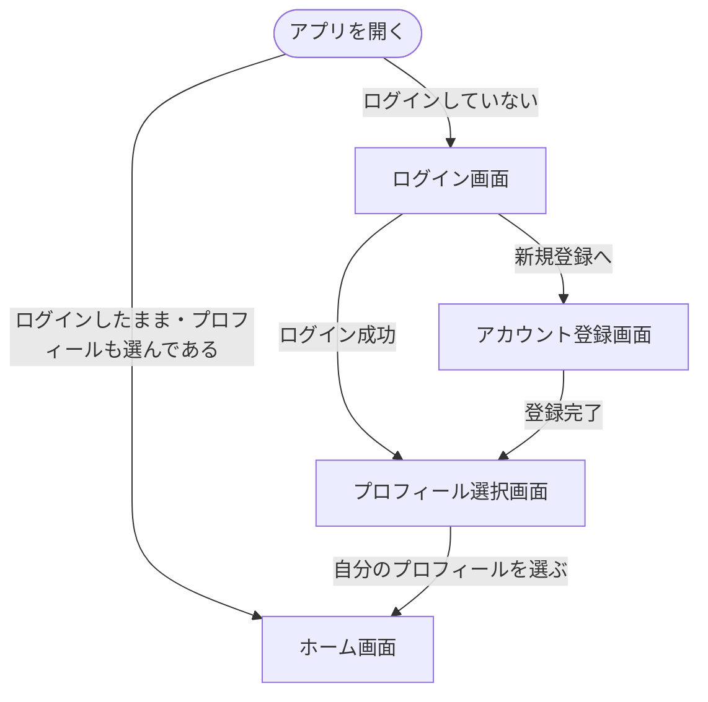
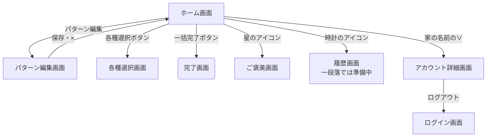
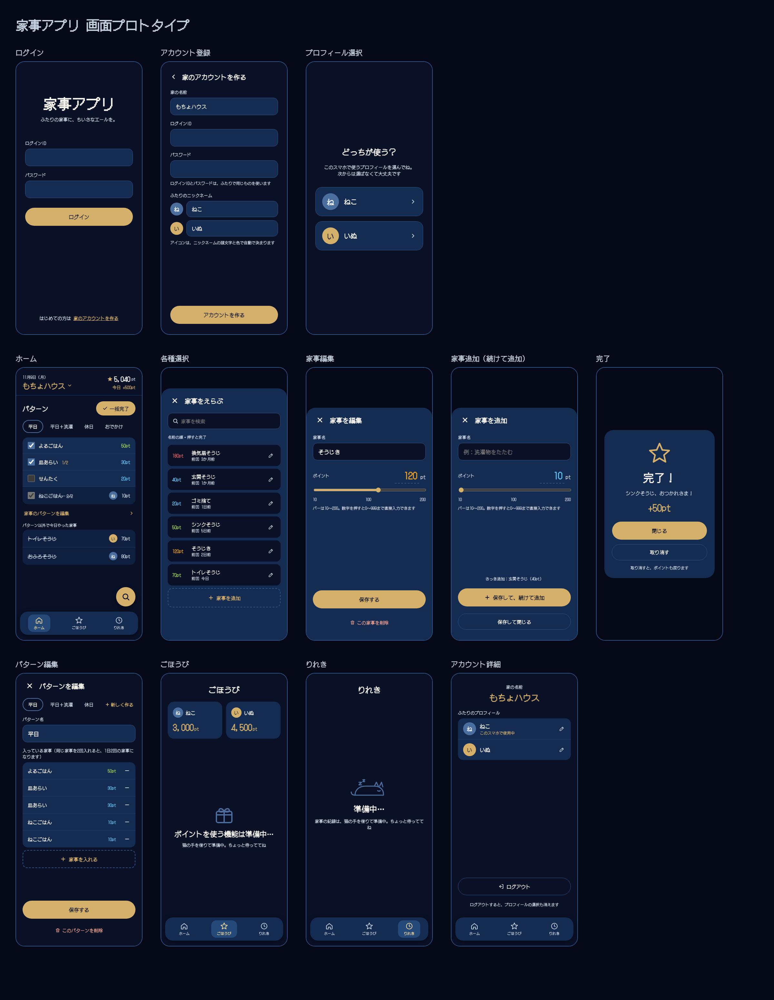

# 画面

## 画面一覧

| 画面 | 何をする画面か | 対応する機能 |
| :--- | :--- | :--- |
| ログイン画面 | 家のアカウントにログインする | 機能1 |
| アカウント登録画面 | 家の名前・ログインの情報・二人のニックネームを決めて、新規登録する | 機能1、機能2 |
| プロフィール選択画面 | そのスマホで初めて使うときに、二人のどちらかを選ぶ | 機能2 |
| ホーム画面 | パターンを選んで一括完了する。ポイントと今日取ったポイントを見る | 機能6、機能8 |
| 家事追加・編集画面 | 家事を追加・編集・削除する | 機能3 |
| パターン編集画面 | パターンを作成・編集・削除する | 機能4 |
| 各種選択画面 | 家事の一覧から検索して、1つずつ完了する。家事の追加・編集もここから | 機能5、機能3 |
| 完了画面 | 完了を知らせる。取り消しもできる | 機能7 |
| ご褒美画面 | 二人のポイントを見る。使う機能は一段落では「準備中」 | 機能8 |
| アカウント詳細画面 | 家の名前と二人のプロフィールを見る。ニックネームの編集とログアウトもここ | 機能1、機能2 |
| 履歴画面 | 一段落では「準備中」 | 機能9、機能10（低） |

---

## 全画面の共通ルール

**移動**
- 一番下のアイコン（猫＝ホーム、星＝ごほうび、時計＝りれき）は、ホーム・ご褒美・履歴・アカウント詳細の画面に常に出る。ほかの画面には出ない
- 入力する画面（家事追加・編集、パターン編集）は、×で確認なしに入力を捨てて、開く前の画面に戻る。保存・追加・削除のあとも、開く前の画面に戻る

**ポップアップとお知らせ**
- 完了画面は、直前の画面に重なるポップアップで出る
- 取り消すと、直前の画面に戻り、「取り消しました」の通知が数秒出て自動で消える

**表示**
- ポイントの数字は大きさで色を変える（0〜49：水色、50〜99：黄緑、100〜149：オレンジ、150以上：赤）。完了してグレーになった家事はグレーのまま

**状態**
- 読み込み中：画面の真ん中にくるくる回るマーク
- 入力が必要な欄が空のとき：その欄の下に赤い文字で伝える
- 通信の失敗
  - 画面を開くときに失敗：画面全体に猫のイラスト、「読み込めませんでした」、「もう一度読み込む」ボタン（アマゾンの通信エラーの犬みたいな？）
  - ボタンを押したときに失敗：今の画面のまま、通知で「〇〇できませんでした」。入力やチェックはそのまま残る

---

## 画面遷移図

**図の見方**
- `[ ]` の四角：ふつうの画面
- `( )` の角が丸い形：ポップアップやお知らせ
- `([ ])` の形：画面ではない、きっかけ（アプリを開く など）
- 一番下のアイコンでの移動（家のアイコンでホームに戻る など）は、図には描いていない

### 図1：ホーム画面に入るまで

### 図2：ホーム画面から

各種選択画面と完了画面から先は、図3。

### 図3：各種選択画面と完了画面

---

## 画面のデザイン

---

## 各画面

読み込み中と通信の失敗は、どの画面も共通ルールのとおり。ここには、画面ごとに違うところだけを書く。

### ホーム画面

- **正常なとき**
  - 上（固定）：今日の日付、家の名前（「∨」でアカウント詳細へ）、持っているポイント、今日取ったポイント。上のポイント表示はホーム画面だけ
  - パターンが横に並ぶ（増えたら横スクロール）。選んでいるパターンは色付きの枠と濃い文字、ほかは枠なしでグレー。パターンを選んでも画面は移動しない
  - 選んでいるパターンの家事が、全部チェックされた状態で並ぶ（ポイント・家事名。1日に複数回の家事は「1/2」）
  - 「一括完了」ボタン
  - 完了した家事は一番下に移り、線が引かれてグレーになる。「家事名・完了した人のアイコン・ポイント」の順
  - 「家事パターンを編集」（パターン編集画面へ）
  - その下に、パターン外で今日1つずつ完了した家事がグレーで並ぶ（複数回なら回数分の行）
  - 右下（固定）：虫眼鏡のボタン（各種選択画面へ）。一番下の家事に重ならないよう、一覧の下に余白を空ける
  - 上と下は固定で、真ん中だけスクロール
- **0件のとき**
  - パターンが1つも無い：作るよう案内し、「パターンを作成」ボタン
  - パターンを選んでいない（選んでいたパターンを削除したときも）：「パターンを選んでください」
  - パターンに家事が無い：「パターンに家事を追加してください」と、パターン編集へのボタン
- **エラーのとき**：一括完了に失敗したら、通知で「完了できませんでした」。チェックは残るので押し直せる

### ログイン画面

- **正常なとき**：ログインの方法は④設計で決める
- **0件のとき**：なし（一覧が無い）
- **エラーのとき**：ログインの情報が違うと、「ログインの情報が違います。もう一度確認してください」。どの情報が違うかは言わない（登録の有無を他人に知られないため）

### アカウント登録画面

- **正常なとき**
  - 家の名前、ログインの情報（④設計で決める）、二人のニックネームを入力して登録する
  - アイコンは選ばない。頭文字と決まった色（1つ目は青、2つ目はオレンジ）で自動で出る
  - 登録が終わると、プロフィール選択画面へ
- **0件のとき**：なし（一覧が無い）
- **エラーのとき**：ログインの情報がほかの家で使われているときの伝え方は、④設計で決める

### プロフィール選択画面

- **正常なとき**：二人のプロフィールから自分を選ぶ。スマホに覚えさせ、次からはこの画面を飛ばす。ログアウトすると選び直す
- **0件のとき**：なし（プロフィールは登録時に必ず2つ作られる）
- **エラーのとき**：共通ルールのとおり

### 家事追加・編集画面

- **正常なとき**
  - 各種選択画面の上に、さらに重なって開く
  - 家事名とポイントを入力する。ポイントはバー（10〜200）か直接入力（0〜999、数字だけ、4桁目は打てない）
  - 鉛筆マークから開くと、中身が入った状態で開き、削除ボタンが出る
  - 編集：保存して各種選択画面へ戻る
  - 追加：「保存して、続けて追加」（画面を閉じずに入力欄が空になり、直前に追加した家事が小さく出る）と「保存して閉じる」
- **0件のとき**：なし（一覧が無い）
- **エラーのとき**：同じ名前の家事は、一段落では登録できてしまう（チェックは後で作る）

### パターン編集画面

- **正常なとき**
  - パターン名を決めて作成する。家事を入れなくても保存できる
  - 登録した家事を入れる。同じ家事を2回入れると1日2回の家事になる（この画面では2行、ホーム画面では1行で「0/2」）
  - 名前と入っている家事を編集できる。回数を減らすときは同じ家事を1つ外す。パターンの削除もここ
- **0件のとき**：家事が1つも無いとき、「登録する家事がありません」と出し、「家事は、ホーム画面の右下の虫眼鏡のボタンから追加できます」と案内する
- **エラーのとき**：共通ルールのとおり

### 各種選択画面

- **正常なとき**
  - ホーム画面の上にシートで開く。×で閉じる（引っぱって閉じるのは後で作る）
  - 上の検索欄で、打った文字を含む家事に絞り込む
  - 家事は名前の順。ポイント・家事名・前回完了した日・鉛筆マークが出る
  - 行を押すとそのまま完了して、完了画面が出る。鉛筆マークで家事追加・編集画面へ
  - 一覧の一番下に、家事と同じ枠で「＋」（追加はほぼ使い始めだけなので、固定にしない）
- **0件のとき**
  - 家事が無い：一覧に「＋」の枠だけ
  - 検索で見つからない：「見つかりませんでした」（例：「検索ゼロ！どこを掘っても見当たらないよ。別のことばで探してみて！」）
- **エラーのとき**：共通ルールのとおり

### 完了画面

- **正常なとき**：「完了！」のポップアップ。「閉じる」で直前の画面へ。「取り消し」で完了とポイントが戻る
- **0件のとき**：なし（一覧が無い）
- **エラーのとき**：共通ルールのとおり

### ご褒美画面

- **正常なとき**：画面の中に二人の持っているポイントを出す（上のポイント表示は出さない）。使う機能は「準備中」（後で作る。②仕様の機能8）
- **0件のとき**：なし（0でも「0pt」と出す）
- **エラーのとき**：共通ルールのとおり

### アカウント詳細画面

- **正常なとき**：家の名前と二人のプロフィールを見る。ニックネームの編集とログアウト（プロフィールの選択も消える）。家の名前の編集は後で作る
- **0件のとき**：なし（プロフィールは必ず2つ）
- **エラーのとき**：共通ルールのとおり

### 履歴画面

- **正常なとき**：一段落では「準備中」（履歴は後で作る）
- **0件のとき**：なし（履歴を作るときに考える）
- **エラーのとき**：共通ルールのとおり
