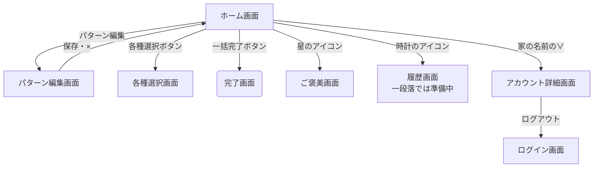
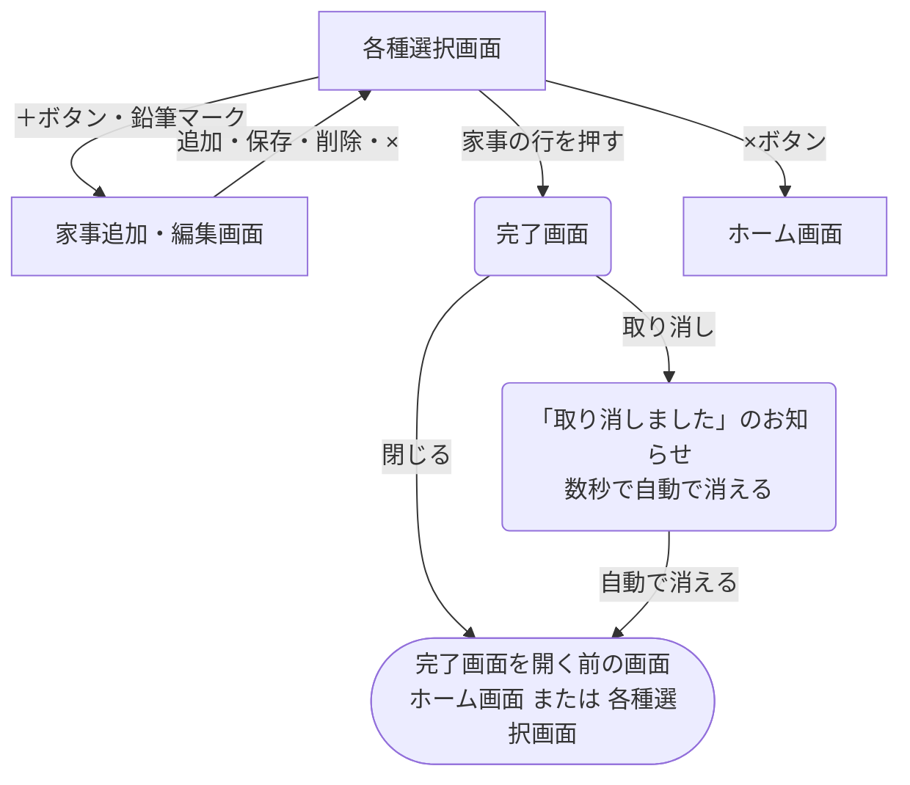
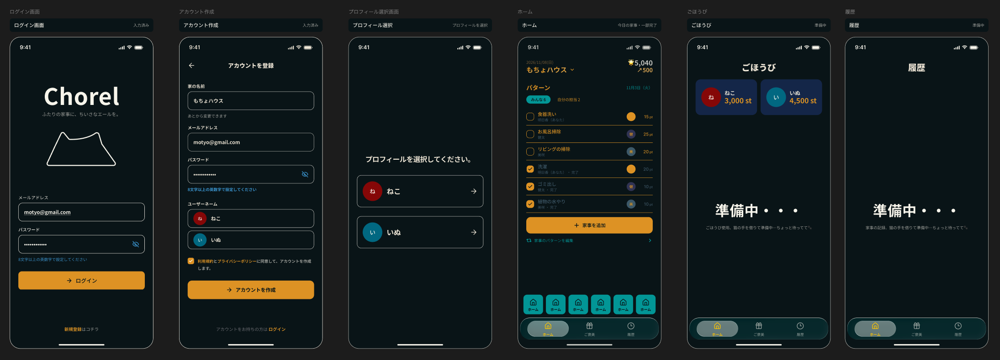

# 画面

## 画面一覧

| 画面 | 何をする画面か | 対応する機能 |
| :--- | :--- | :--- |
| ログイン画面 | 家のアカウントにログインする | 機能1 |
| アカウント登録画面 | 家の名前・ログインの情報・二人のニックネームを決めて、家のアカウントを新規登録する | 機能1、機能2 |
| プロフィール選択画面 | そのスマホで初めて使うときに、二人のどちらかを選ぶ | 機能2 |
| ホーム画面 | パターンを選んで一括完了する。ポイントと今日取ったポイントを見る | 機能6、機能8 |
| 家事追加・編集画面 | 各種選択画面の＋ボタンから開くと、家事を追加できる。鉛筆マークから開くと、中身が入った状態で開き、編集・削除できる | 機能3 |
| パターン編集画面 | パターンを作成・編集・削除する | 機能4 |
| 各種選択画面 | 家事の一覧から、検索で探して、家事を1つずつ完了する。家事の追加・編集もここから | 機能5、機能3 |
| 完了画面 | 完了したことを知らせる。取り消しもできる | 機能7 |
| ご褒美画面 | 自分と相手の持っているポイントを見る。ポイントを使う機能は、一段落では「準備中」 | 機能8 |
| アカウント詳細画面 | 家の名前と二人のプロフィールを見る。この画面の中で、ニックネームの編集とログアウトもできる | 機能1、機能2 |
| 履歴画面 | 一段落では「準備中」と表示する | 機能9、機能10（低） |

---

## 画面遷移図

**画面の共通ルール**
- パターンを選ぶ操作は、ホーム画面の中で行う（画面は移動しない）
- 一番下のアイコン（猫＝ホーム、星＝ごほうび、時計＝りれき）は、次の画面に常に表示され、いつでも移動できる：ホーム画面、ご褒美画面、履歴画面、アカウント詳細画面
- 一番下のアイコンが出ない画面：ログイン画面、アカウント登録画面、プロフィール選択画面（ホームに入る前の画面）、各種選択画面、家事追加・編集画面、パターン編集画面
- ホーム画面の上の部分（日付・家の名前・ポイント・今日取ったポイント）と、下の部分（一番下のアイコン）と、右下の虫眼鏡のボタンは固定で、真ん中だけがスクロールする。虫眼鏡のボタンが一覧の一番下の家事に重ならないように、一覧の下にボタンの高さぶんの余白を空ける
- 上のポイントの表示は、ホーム画面だけに出す。ご褒美画面では、画面の中に自分と相手の持っているポイントを出す
- 各種選択画面は、ホーム画面の上に、下から引き出すシートのように重なって開く。一段落では、×ボタンで閉じる（シートを下に引っぱって閉じる操作は、後で作る）
- 家事追加・編集画面は、各種選択画面の上に、さらに重なって開く
- 家事追加・編集画面とパターン編集画面には×ボタンがある。押すと、確認は出さずに入力した内容を捨てて、開く前にいた画面に戻る。保存・追加・削除をしたときも、開く前にいた画面に戻る
- 各種選択画面では、家事の一つ一つに鉛筆マークがいつも表示されている。押すと、その家事の家事追加・編集画面が開く。削除は、その画面の中の削除ボタンで行う
- 完了画面は、直前の画面が透けて見える状態で、ポップアップのように重なって出る
- 完了画面で取り消しを押すと、完了画面が閉じて直前の画面に戻り、「取り消しました」というお知らせ（トースト）が短く出て、数秒で自動で消える。閉じるボタンは無い
- 一番下のアイコンでの移動（家のアイコンでホームに戻る など）は、図には描いていない
- メッセージの言葉づかいは、場面で使い分ける（例は、下の「メッセージの例」を参照）
  - うれしい場面（完了したとき、準備中の画面など）：フランクで楽しい言葉にする
  - アプリ側のエラー（通信の失敗、ページが見つからない など）：ユーモアのある言葉にしてよい。アプリ（猫）が自分のせいにする形にして、使う人のせいにしない
  - 使う人の入力の間違い（ログインの情報の間違い、空欄 など）：ふざけずに、ふつうの丁寧な言葉にする。からかっているように感じさせない
  - どの場面でも、何が起きたかと、次に何をすればいいか（「もう一度読み込む」ボタンなど）は必ず伝える
- 読み込み中は、どの画面でも、画面の真ん中にくるくる回るマークを出す
- 入力が必要な欄が空のままボタンを押したときは、どの画面でも、その欄の下に赤い文字で伝える
- 通信に失敗したときは、どの画面でも次の形にする
  - 画面を開くときに失敗したとき（データが取れない）：画面全体に、猫のイラストと「読み込めませんでした」、「もう一度読み込む」ボタンを出す
  - ボタンを押したときに失敗したとき（一括完了、保存、ポイントを使う など）：今の画面のまま、トーストで「〇〇できませんでした」と短く出す。入力やチェックはそのまま残る

**メッセージの例（候補）**

アプリ側のエラーや読み込み中に使いたい、猫のメッセージの候補。実際に使う言葉は、作るときに選ぶ。

| 場面 | メッセージの例 |
| :--- | :--- |
| 通信に失敗したとき | 「ごめんなさい！サーバーのコードで猫がじゃれ合って絡まってしまいました。今ほぐしています…」 |
| 通信に失敗したとき | 「ごめんなさい！スマホの画面の上に猫が座り込んじゃって、通信が遮断されちゃったみたい。もう一度試してみて？」 |
| 通信に失敗したとき | 「寂しくて、今あなたのスマホの仮想キーボードを踏んづけて歩いてます。asdfghjkl」 |
| 読み込み中 | 「データを集めています。猫が日向ぼっこから戻ってくるくらい（すぐ）終わるからね！」 |
| 読み込み中 | 「（じーーっ👀）猫が獲物を狙うような真剣さで、次の画面を準備しています。そのままキープ！」 |
| ページが見つからないとき | 「探していたページが見つかりません。たぶんタンスの裏か、冷蔵庫の上に隠れちゃったんだと思います…」 |

**図の見方**
- `[ ]` の四角：ふつうの画面
- `( )` の角が丸い形：ポップアップやお知らせ（完了画面・取り消しのお知らせ）
- `([ ])` の形：画面ではない、きっかけ（アプリを開く など）

### 図1：ホーム画面に入るまで

### 図2：ホーム画面から

各種選択画面と完了画面から先は、図3。

### 図3：各種選択画面と完了画面

---

## 画面のデザイン（Figma・作成途中）

※作成途中。ホーム画面はまだ途中で、ほかの画面はまだ作っていない。ログイン画面とアカウント作成画面の、メールアドレス・パスワード（8文字以上の英数字）・利用規約への同意は、テンプレートのまま置いている。ログインの方法は④設計で決め、利用規約とプライバシーポリシーは後回しにする

## 各画面

### ホーム画面

- **正常なとき**：
  - 上（固定）：今日の日付と、家の名前（「∨」でアカウント詳細画面へ）。右に、自分の持っているポイントと、その下に自分が今日取ったポイント
  - パターンが横に並ぶ。増えたら横にスクロールする。選んでいるパターンは色付きの枠で文字が濃く、選んでいないパターンは枠なしでグレーの文字
  - 選んでいるパターンの家事が、全部チェックされた状態で並ぶ。各家事には、ポイントと家事名が出る。1日に複数回やる家事は「1/2」のように回数が出る
  - 「一括完了」ボタン
  - 完了した家事は、一覧の一番下に移動し、線が引かれてグレーになり、完了した人のアイコンが出る
  - 「家事パターンを編集」（パターン編集画面へ）
  - その下に線で区切って、パターンに入っていない家事のうち、今日1つずつ完了したものがグレーで並ぶ。複数回完了したときは、その回数だけ行が並ぶ
  - 右下（固定）：虫眼鏡のボタン。押すと、各種選択画面（家事の一覧）が開く
  - 一番下（固定）：猫（ホーム）・星（ごほうび）・時計（りれき）のアイコン
  - 上と下は固定で、真ん中だけがスクロールする
- **読み込み中**：共通ルールのとおり（くるくる回るマーク）
- **0件のとき**：
  - パターンが1つも作られていないとき（使い始めたばかりのとき）：パターンを作るように案内し、「パターンを作成」ボタンを出す（押すとパターン編集画面へ）
  - パターンを1つも選んでいないとき（選んでいたパターンを削除したときも）：「パターンを選んでください」と表示する
  - 選んでいるパターンに家事が1つも入っていないとき：「パターンに家事を追加してください」と表示し、パターン編集画面へ行くボタンを出す
- **エラーのとき**：
  - 通信に失敗したとき：共通ルールのとおり
  - 一括完了ボタンを押して失敗したとき：トーストで「完了できませんでした」と出す。チェックの状態はそのまま残るので、もう一度押せばやり直せる

---

### ログイン画面

- **正常なとき**：
- **読み込み中**：共通ルールのとおり（くるくる回るマーク）
- **0件のとき**：なし（一覧を出す画面ではないため）
- **エラーのとき**：
  - 通信に失敗したとき：共通ルールのとおり
  - ログインの情報が間違っているとき：「ログインの情報が違います。もう一度確認してください」と赤い文字で出す。どの情報（メールアドレスかパスワードか など）が違うのかは言わない（登録されているかどうかを、他人に知られないため）

---

### アカウント登録画面

- **正常なとき**：
  - 家の名前と、ログインの情報（④設計で決める）と、二人のニックネームを入力して、家のアカウントを新規登録する
  - アイコンは選ばない。ニックネームの頭文字と、決まった色（1つ目は青、2つ目はオレンジ）で、自動で表示される
  - 登録が終わると、プロフィール選択画面へ進む
- **読み込み中**：共通ルールのとおり（くるくる回るマーク）
- **0件のとき**：なし（一覧を出す画面ではないため）
- **エラーのとき**：
  - 通信に失敗したとき：共通ルールのとおり
  - 二人のニックネームのどちらかが空のとき：登録できない。共通ルールのとおり
  - ログインの情報が、ほかの家ですでに使われているとき：どう伝えるかは、ログインの方法と一緒に④設計で決める

---

### プロフィール選択画面

- **正常なとき**：
  - 二人のプロフィール（アイコンとニックネーム）が並び、自分のほうを押して選ぶ
  - 選んだプロフィールはスマホに覚えさせ、次にアプリを開いたときは、この画面を飛ばしてホーム画面から始まる
  - ログアウトすると、選択も消え、次にログインしたときにまたこの画面が出る
- **読み込み中**：共通ルールのとおり（くるくる回るマーク）
- **0件のとき**：なし（プロフィールは、新規登録のときに必ず2つ作られるため）
- **エラーのとき**：
  - 通信に失敗したとき：共通ルールのとおり
---

### 家事追加・編集画面

- **正常なとき**：
  - 各種選択画面の上に、さらに重なって開く
  - 家事名とポイントを入力する
  - ポイントは、バー（10〜200）で決めるか、数字を押して直接入力する（0〜999、数字だけ。4桁目は打てない）
  - 各種選択画面の鉛筆マークから開いたときは、その家事の内容が入った状態で開き、削除ボタンが出る
  - 保存ボタンで保存して、各種選択画面に戻る
  - ×ボタンで、確認なしで入力を捨てて、各種選択画面に戻る
- **読み込み中**：共通ルールのとおり（くるくる回るマーク）
- **0件のとき**：なし（一覧を出す画面ではないため）
- **エラーのとき**：
  - 通信に失敗したとき：共通ルールのとおり
  - 家事名が空のとき：保存できない。共通ルールのとおり、欄の下に赤い文字で伝える
  - 同じ名前の家事は、一段落では登録できてしまう（チェックは一段落の後に作る。②仕様の機能3を参照）

---

### パターン編集画面

- **正常なとき**：
  - 家事を1つも入れないままでも、パターンを保存できる（そのパターンを選ぶと、ホーム画面に「パターンに家事を追加してください」と出る）
  - パターン名を決めて、パターンを作成できる
  - 登録した家事をパターンに入れられる。同じ家事を2回入れると、1日に2回やる家事になる（パターン編集画面では2行並び、ホーム画面では1行にまとまって「0/2」のように出る）
  - 名前・入っている家事を編集でき、パターンを削除できる。回数を減らすときは、同じ家事を1つ取り外す
  - ×ボタンで、確認なしで入力を捨てて、開く前の画面に戻る
- **読み込み中**：共通ルールのとおり（くるくる回るマーク）
- **0件のとき**：
  - 家事がまだ1つも登録されていないとき：パターンに入れる家事の欄に「登録する家事がありません」と出し、「家事は、ホーム画面の右下の虫眼鏡のボタンから追加できます」と案内する
- **エラーのとき**：
  - 通信に失敗したとき：共通ルールのとおり
  - パターン名が空のとき：保存できない。共通ルールのとおり

---

### 各種選択画面

- **正常なとき**：
  - ホーム画面の上に、下から引き出すシートのように重なって開く。左上の×で閉じる（下に引っぱって閉じる操作は、後で作る）
  - 上に検索欄がある。文字を打つと、その文字を含む家事だけに絞り込まれる
  - 家事が、名前の順に並ぶ。各家事に、ポイント・家事名・前回完了した日（2日前、1か月前など）・鉛筆マークが出る
  - 家事の行を押すと、そのまま完了になり、完了画面が出る
  - 鉛筆マークを押すと、その家事の家事追加・編集画面が開く
  - 家事の一覧の一番下に、家事と同じ枠で、家事を追加する「＋」ボタンを置く（家事を追加するのは、ほとんど使い始めのころだけで、毎日増えるものではないため。固定にしないので、一覧の家事に重ならない）
  - 一番下のアイコンは出ない
- **読み込み中**：共通ルールのとおり（くるくる回るマーク）
- **0件のとき**：
  - 家事が1つも登録されていないとき：一覧には、家事を追加する「＋」の枠だけが出る
  - 検索で当てはまる家事が1つも無いとき：「見つかりませんでした」と出す（例：「検索ゼロ！どこを掘っても見当たらないよ。別のことばで探してみて！」）
- **エラーのとき**：
  - 通信に失敗したとき：共通ルールのとおり

---

### 完了画面

- **正常なとき**：
  - 直前の画面が透けて見える状態で、「完了！」がポップアップのように重なって出る
  - 「閉じる」で直前の画面に戻る
  - 「取り消し」で完了が取り消されてポイントも戻り、直前の画面に戻って「取り消しました」のお知らせが数秒出る
- **読み込み中**：共通ルールのとおり（くるくる回るマーク）
- **0件のとき**：なし（一覧を出す画面ではないため）
- **エラーのとき**：
  - 通信に失敗したとき：共通ルールのとおり

---

### ご褒美画面

- **正常なとき**：
  - 画面の中に、自分と相手の持っているポイントが出る（上のポイント表示は出さない）
  - ポイントを使う機能は、一段落では「準備中」と表示する（換算やバーで使う機能は、一段落の後に作る。②仕様の機能8を参照）
- **読み込み中**：共通ルールのとおり（くるくる回るマーク）
- **0件のとき**：なし（ポイントが0でも、「0pt」と数字で出すため）
- **エラーのとき**：
  - 通信に失敗したとき：共通ルールのとおり
---

### アカウント詳細画面

- **正常なとき**：
  - 家の名前と、二人のプロフィール（アイコンとニックネーム）が見られる
  - プロフィールのニックネームを編集できる。アイコンは、ニックネームの頭文字と、決まった色で表示される
  - ログアウトできる（ログアウトすると、プロフィールの選択も消える）
  - 家の名前の編集は、一段落の後に作る
- **読み込み中**：共通ルールのとおり（くるくる回るマーク）
- **0件のとき**：なし（プロフィールは必ず2つあるため）
- **エラーのとき**：
  - 通信に失敗したとき：共通ルールのとおり
  - ニックネームが空のとき：保存できない。共通ルールのとおり
---

### 履歴画面

- **正常なとき**：
  - 一段落の時点では「準備中」と表示する（履歴は一段落の後に作る）
- **読み込み中**：共通ルールのとおり（くるくる回るマーク）
- **0件のとき**：なし（一段落では「準備中」を出すだけのため。履歴を作るときに考える）
- **エラーのとき**：
  - 通信に失敗したとき：共通ルールのとおり
