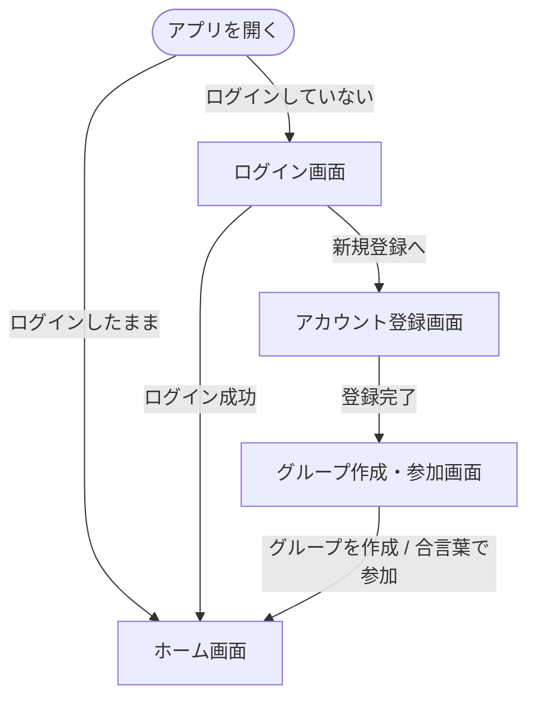
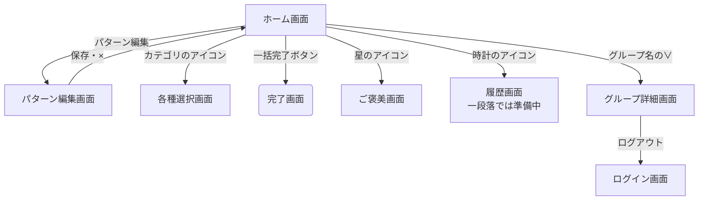
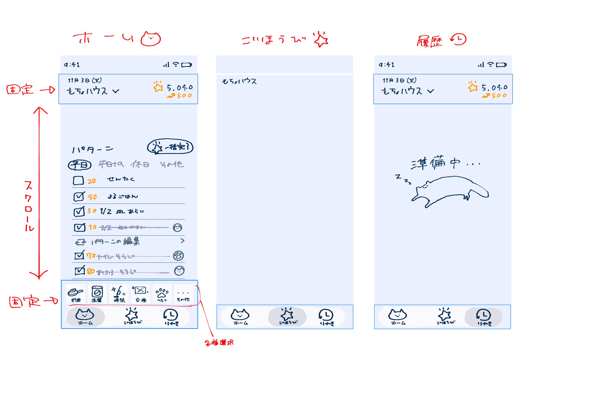
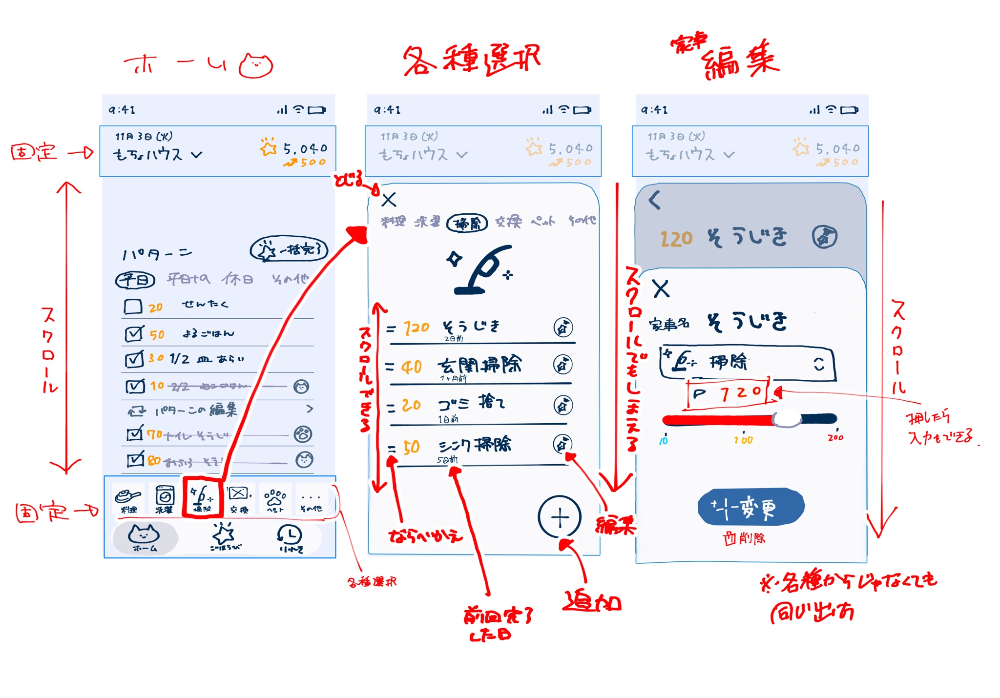
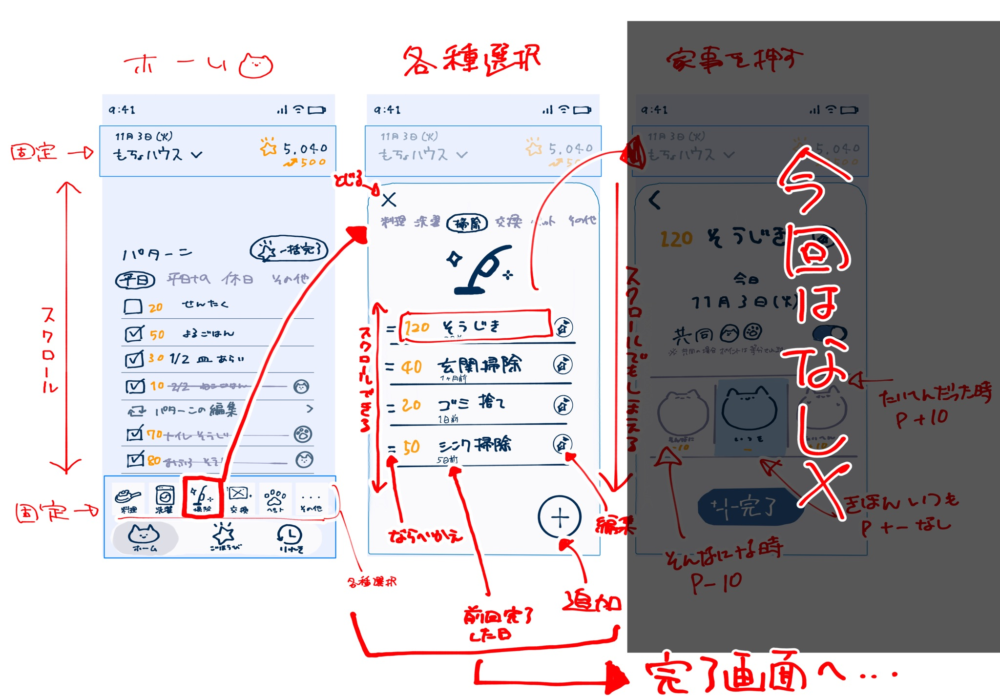

# 画面

## 画面一覧

| 画面 | 何をする画面か | 対応する機能 |
| :--- | :--- | :--- |
| ログイン画面 | ログインする | 機能2 |
| アカウント登録画面 | ニックネームとアイコンを決めて、新規登録する | 機能2 |
| グループ作成・参加画面 | グループを作るか、合言葉で参加する | 機能1 |
| ホーム画面 | パターンを選んで一括完了する。ポイントと今日取ったポイントを見る | 機能6、機能8 |
| 家事追加・編集画面 | 各種選択画面の＋ボタンから開くと、家事を追加できる。鉛筆マークから開くと、中身が入った状態で開き、編集・削除できる | 機能3 |
| パターン編集画面 | パターンを作成・編集・削除する | 機能4 |
| 各種選択画面 | カテゴリごとの家事の一覧から、家事を1つずつ完了する。家事の追加・編集もここから | 機能5、機能3 |
| 完了画面 | 完了したことを知らせる。取り消しもできる | 機能7 |
| ご褒美画面 | 所持ポイントと換算した金額を見て、ポイントを使う。相手のポイントも見る | 機能8 |
| グループ詳細画面 | メンバー・グループ名・合言葉を見る。この画面の中で、アカウントの編集（アイコン・ニックネーム）とログアウトもできる | 機能1、機能2 |
| 履歴画面 | 一段落では「準備中」と表示する | 機能9、機能10（低） |

### 機能ごとの確認

②仕様のすべての機能に、対応する画面があるかを確かめるための表。

| 機能 | 優先度 | どの画面で使うか |
| :--- | :--- | :--- |
| 機能1：グループ共有 | 高 | グループ作成・参加画面、グループ詳細画面 |
| 機能2：アカウント | 高 | ログイン画面、アカウント登録画面、グループ詳細画面（アカウント編集・ログアウト） |
| 機能3：家事の追加・編集・削除 | 高 | 家事追加・編集画面（追加は各種選択画面の＋ボタン、編集・削除は各種選択画面の鉛筆マークから） |
| 機能4：パターンの作成・編集・削除 | 高 | パターン編集画面 |
| 機能5：各種選択 | 高 | 各種選択画面 |
| 機能6：パターンで一括完了 | 高 | ホーム画面 |
| 機能7：完了画面 | 高 | 完了画面、取り消しのお知らせ |
| 機能8：ご褒美システム | 高 | ご褒美画面、ホーム画面（ポイント表示） |
| 機能9：ご褒美の使用履歴 | 低 | 履歴画面（一段落では準備中） |
| 機能10：家事の完了履歴 | 低 | 履歴画面（一段落では準備中） |

---

## 画面遷移図

**画面の共通ルール**
- パターンを選ぶ操作は、ホーム画面の中で行う（画面は移動しない）
- 一番下のアイコン（猫＝ホーム、星＝ごほうび、時計＝りれき）は、次の画面に常に表示され、いつでも移動できる：ホーム画面、ご褒美画面、履歴画面、グループ詳細画面
- 一番下のアイコンが出ない画面：ログイン画面、アカウント登録画面、グループ作成・参加画面（ホームに入る前の画面）、各種選択画面、家事追加・編集画面、パターン編集画面
- ホーム画面の上の部分（日付・グループ名・ポイント・今日取ったポイント）と、下の部分（カテゴリのアイコン・一番下のアイコン）は固定で、真ん中だけがスクロールする
- 上のポイントの表示は、ホーム画面だけに出す。ご褒美画面では、画面の中に所持ポイントと換算した金額を出す
- 各種選択画面は、ホーム画面の上に、下から引き出すシートのように重なって開く。×か、下にスクロールして閉じる
- 家事追加・編集画面は、各種選択画面の上に、さらに重なって開く
- 家事追加・編集画面とパターン編集画面には×ボタンがある。押すと、確認は出さずに入力した内容を捨てて、開く前にいた画面に戻る。保存・追加・削除をしたときも、開く前にいた画面に戻る
- 各種選択画面では、家事の一つ一つに鉛筆マークがいつも表示されている。押すと、その家事の家事追加・編集画面が開く。削除は、その画面の中の削除ボタンで行う
- 完了画面は、直前の画面が透けて見える状態で、ポップアップのように重なって出る
- 完了画面で取り消しを押すと、完了画面が閉じて直前の画面に戻り、「取り消しました」というお知らせ（トースト）が短く出て、数秒で自動で消える。閉じるボタンは無い
- 一番下のアイコンでの移動（家のアイコンでホームに戻る など）は、図には描いていない

**図の見方**
- `[ ]` の四角：ふつうの画面
- `( )` の角が丸い形：ポップアップやお知らせ（完了画面・取り消しのお知らせ）
- `([ ])` の形：画面ではない、きっかけ（アプリを開く など）

### 図1：ホーム画面に入るまで

### 図2：ホーム画面から

各種選択画面と完了画面から先は、図3。

### 図3：各種選択画面と完了画面

---

## 各画面

### ホーム画面

- **正常なとき**：
  - 上（固定）：今日の日付と、グループ名（「∨」でグループ詳細画面へ）。右に、自分の持っているポイントと、その下に自分が今日取ったポイント
  - パターンが横に並ぶ。増えたら横にスクロールする。選んでいるパターンは色付きの枠で文字が濃く、選んでいないパターンは枠なしでグレーの文字
  - 選んでいるパターンの家事が、全部チェックされた状態で並ぶ。各家事には、ポイントと家事名が出る。1日に複数回やる家事は「1/2」のように回数が出る
  - 「一括完了」ボタン
  - 完了した家事は、一覧の一番下に移動し、線が引かれてグレーになり、完了した人のアイコンが出る
  - 「家事パターンを編集」（パターン編集画面へ）
  - その下に線で区切って、パターンに入っていない家事のうち、今日1つずつ完了したものがグレーで並ぶ。複数回完了したときは、その回数だけ行が並ぶ
  - 下（固定）：カテゴリのアイコン（料理・洗濯・掃除・交換・ペット・その他）。押すと、そのカテゴリの各種選択画面が開く
  - 一番下（固定）：猫（ホーム）・星（ごほうび）・時計（りれき）のアイコン
  - 上と下は固定で、真ん中だけがスクロールする
- **読み込み中**：
- **0件のとき**：
  - パターンを1つも選んでいないとき（選んでいたパターンを削除したときも）：「パターンを選んでください」と表示する
- **エラーのとき**：

---

### ログイン画面

- **正常なとき**：
- **読み込み中**：
- **0件のとき**：
- **エラーのとき**：

---

### アカウント登録画面

- **正常なとき**：
  - ニックネームを入力し、アイコンを用意した中から選んで、新規登録する（ログインに使う情報は④設計で決める）
- **読み込み中**：
- **0件のとき**：
- **エラーのとき**：

---

### グループ作成・参加画面

- **正常なとき**：
  - グループ名と合言葉を決めて、グループを作成できる
  - 合言葉を入力して、グループに参加できる
- **読み込み中**：
- **0件のとき**：
- **エラーのとき**：
  - 合言葉を間違えると、グループに参加できない（どう伝えるかは未定）
  - グループは二人が上限なので、三人目は参加できない（どう伝えるかは未定）

---

### 家事追加・編集画面

- **正常なとき**：
  - 各種選択画面の上に、さらに重なって開く
  - 家事名・家事カテゴリ（掃除、料理など）・ポイントを入力する
  - 各種選択画面の＋ボタンから開いたときは、そのとき開いていたカテゴリが最初から選ばれている
  - ポイントは、バー（10〜200）で決めるか、数字を押して直接入力する（0〜999、数字だけ。4桁目は打てない）
  - 各種選択画面の鉛筆マークから開いたときは、その家事の内容が入った状態で開き、削除ボタンが出る
  - 保存ボタンで保存して、各種選択画面に戻る
  - ×ボタンで、確認なしで入力を捨てて、各種選択画面に戻る
- **読み込み中**：
- **0件のとき**：
- **エラーのとき**：

---

### パターン編集画面

- **正常なとき**：
  - パターン名を決めて、パターンを作成できる
  - 登録した家事をパターンに入れ、家事ごとに1日の回数を決められる
  - 名前・入っている家事・回数を編集でき、パターンを削除できる
  - ×ボタンで、確認なしで入力を捨てて、開く前の画面に戻る
- **読み込み中**：
- **0件のとき**：
- **エラーのとき**：

---

### 各種選択画面

- **正常なとき**：
  - ホーム画面の上に、下から引き出すシートのように重なって開く。左上の×か、下にスクロールして閉じる
  - 上にカテゴリが横に並び、開いているカテゴリが丸で囲まれる。押すと、別のカテゴリに切り替わる
  - カテゴリのイラスト
  - そのカテゴリの家事が、名前の順に並ぶ。各家事に、ポイント・家事名・前回完了した日（2日前、1か月前など）・鉛筆マークが出る
  - 家事の行を押すと、そのまま完了になり、完了画面が出る
  - 鉛筆マークを押すと、その家事の家事追加・編集画面が開く
  - 右下（固定）に、家事を追加する「＋」ボタン
  - 一番下のアイコンは出ない
- **読み込み中**：
- **0件のとき**：
- **エラーのとき**：

---

### 完了画面

- **正常なとき**：
  - 直前の画面が透けて見える状態で、「完了！」がポップアップのように重なって出る
  - 「閉じる」で直前の画面に戻る
  - 「取り消し」で完了が取り消されてポイントも戻り、直前の画面に戻って「取り消しました」のお知らせが数秒出る
- **読み込み中**：
- **0件のとき**：
- **エラーのとき**：

---

### ご褒美画面

- **正常なとき**：
  - 画面の中に、自分の持っているポイントと、それを換算した金額が出る（上のポイント表示は出さない）
  - 相手の持っているポイントも見られる
  - ポイントとお金の換算（例：3pt＝1円）を、グループの誰でも設定・編集できる
  - 使うポイントをバーで指定して使える。バーは、自分の持っているポイントまでしか動かせない
- **読み込み中**：
- **0件のとき**：
- **エラーのとき**：

---

### グループ詳細画面

- **正常なとき**：
  - メンバー・グループ名・合言葉が見られる（同居人を招待するときは、ここで合言葉を見て伝える）
  - アカウントの編集（アイコンとニックネーム）ができる
  - ログアウトできる
  - グループの編集は、一段落の後に作る
- **読み込み中**：
- **0件のとき**：
- **エラーのとき**：

---

### 履歴画面

- **正常なとき**：
  - 一段落の時点では「準備中」と表示する（履歴は一段落の後に作る）
- **読み込み中**：
- **0件のとき**：
- **エラーのとき**：
