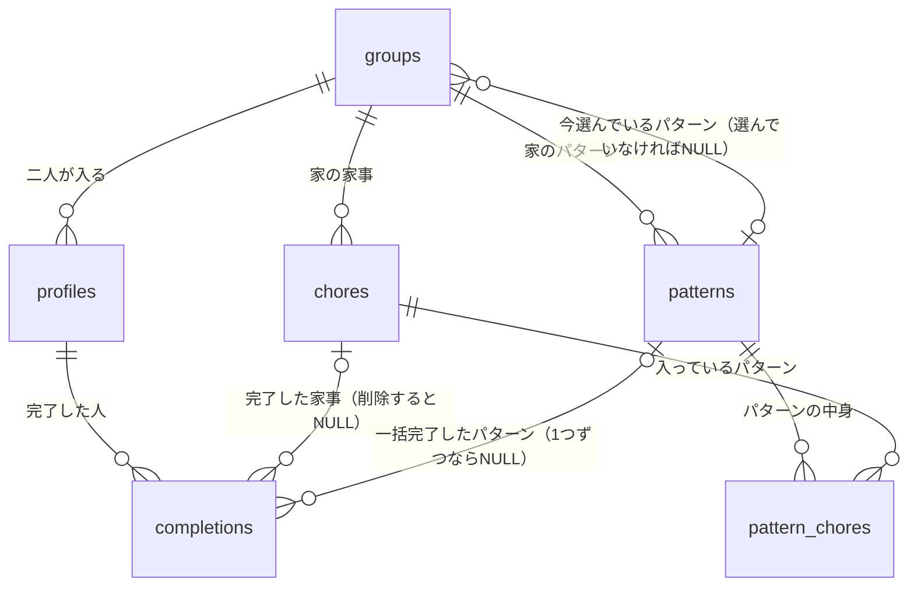

# 設計

## テーブル設計

### テーブル一覧

| テーブル | 何を入れるか（1行が表すもの） |
| :--- | :--- |
| groups | 1つの家（ログインの情報を持つ）。②仕様・③画面の「家のアカウント」のこと |
| profiles | 家の中の1人 |
| chores | 登録した家事1つ |
| patterns | 平日・休日などのパターン1つ |
| pattern_chores | 「平日に、皿あらいが入っている」という組み合わせ1つ（中間テーブル） |
| completions | 「誰かが、ある家事を、ある日時に完了した」1回分（完了の記録） |

### ER図

**図の見方**：線のはしの記号は、その側のテーブルが何行あるか（`||` ちょうど1つ、`|o` 0か1つ、`o{` 0以上）。例：`groups ||--o{ profiles` は「1つの家に、プロフィールが0以上」

### 各テーブルのカラム

#### groups

| カラム | 型 | NULL | 説明・なぜこうしたか |
| :--- | :--- | :--- | :--- |
| group_id | Int | しない | 家の番号（1、2、3…と自動で増える） |
| name | VarChar(20) | しない | 家の名前 |
| email | VarChar(255) | しない | ログインに使う。同じメールアドレスは登録できない（ユニーク）。ログインのときに、どの家か1つに決められるようにするため。2人が同時に同じメールアドレスで登録しようとしても、データベースが防ぐ |
| password | VarChar(255) | しない | ハッシュ化して保存する。bcrypt のハッシュは60文字だが、後でハッシュの方法を変えても入るように、余裕を持たせて255文字 |
| selected_pattern_id | Int | 許可 | 今選んでいるパターン。家に1つなので、家を表すこのテーブルに置く。切り替えるときは1か所を書き換えるだけで、2つ同時に選ばれることが起きない。選んでいないとき（使い始め、選んでいたパターンを削除したとき）は NULL。パターンを削除したら、自動で NULL にする |

- プロフィールの番号は持たない。1対たくさんなので、外部キーは「たくさん」のほう（profiles の group_id）にだけ置く。両方に書くと食い違うことがあるため
- patterns とは2本でつながる。「どの家のパターンか」は patterns の group_id、「今選んでいるパターン」は groups の selected_pattern_id。Prisma では2本に別々の名前を付ける

#### profiles

| カラム | 型 | NULL | 説明・なぜこうしたか |
| :--- | :--- | :--- | :--- |
| profile_id | Int | しない | プロフィールの番号（自動で増える） |
| group_id | Int | しない | どの家の人か |
| name | VarChar(20) | しない | ニックネーム |

- 二人とも同じカラムなので、1人目・2人目でテーブルを分けず、1つのテーブルに2行入れる
- ポイントのカラムは持たない（下の「ポイントの持ち方」を参照）
- アイコンのカラムは持たない。画面で計算する（文字：ニックネームの1文字目、色：profile_id が小さいほうが青、大きいほうがオレンジ）。「アイコンを選ぶ」を作るときに足す

#### chores

| カラム | 型 | NULL | 説明・なぜこうしたか |
| :--- | :--- | :--- | :--- |
| chore_id | Int | しない | 家事の番号（自動で増える） |
| group_id | Int | しない | どの家の家事か。家事は家のもので、二人とも完了できる |
| chore_name | VarChar(20) | しない | 家事の名前 |
| point | Int | しない | 家事のポイント（0〜999。②仕様の機能3） |

- 前回完了した日は持たない。completions の一番新しい日時（MAX）を取る。カラムで持つと、取り消したときに前の日付に戻せないため
- 1日に何回やるかは持たない。回数は、パターンに同じ家事を何回入れるかで決める（pattern_chores を参照）

#### patterns

| カラム | 型 | NULL | 説明・なぜこうしたか |
| :--- | :--- | :--- | :--- |
| pattern_id | Int | しない | パターンの番号（自動で増える） |
| group_id | Int | しない | どの家のパターンか |
| name | VarChar(8) | しない | パターンの名前（平日、休日など）。ホーム画面の横並びのボタンになるので、最初の画面に2〜3個見えるように、ほかの名前より短い8文字 |

- 日付は持たない。朝5時のリセットは、今日の completions だけを取れば起きるため

#### pattern_chores

| カラム | 型 | NULL | 説明・なぜこうしたか |
| :--- | :--- | :--- | :--- |
| pattern_chore_id | Int | しない | 組み合わせ1つの番号（自動で増える） |
| pattern_id | Int | しない | どのパターンか |
| chore_id | Int | しない | どの家事か |

- 同じ家事を2回入れると、1日2回になる（同じ組み合わせが2行）。「0/2」の「2」は、この行を数える（COUNT）
- よくある中間テーブルは pattern_id と chore_id の組み合わせを目印にするが、それだと同じ組み合わせを2行入れられないので、pattern_chore_id を持たせる。2行あっても、1行だけを指して消せる
- パターンや家事を削除したら、この行も自動で消える

#### completions

| カラム | 型 | NULL | 説明・なぜこうしたか |
| :--- | :--- | :--- | :--- |
| completion_id | Int | しない | 完了の記録の番号（自動で増える） |
| profile_id | Int | しない | 誰が完了したか。名前やアイコンはコピーせず、番号でプロフィールを見に行く（後でニックネームを変えても、記録を直さなくて済むため） |
| chore_id | Int | 許可 | どの家事を完了したか。家事を削除したら NULL にする（記録は残したいため） |
| chore_name | VarChar(20) | しない | 完了したときの家事の名前をコピーする。家事を編集・削除しても、過去の記録は「そのときの内容のまま」残すため（②仕様の機能3） |
| point | Int | しない | 完了したときのポイントをコピーする。理由は chore_name と同じ |
| pattern_id | Int | 許可 | 一括完了したときのパターン。1つずつ完了したときは、パターンを使っていないので NULL。パターンを削除したら NULL にする（記録は残したいため） |
| completed_at | DateTime | しない | いつ完了したか |

- group_id は持たない。profile_id から profiles をたどれば分かるため
- 家事を消さずに「削除した印」を付ける方法も考えたが、名前のコピーにした。「そのときの内容のまま」残せて、家事の一覧のたびに印で絞り込む必要もないため

### ポイントの持ち方

ポイントは、profiles にカラムとして持たず、completions から計算する。

- 持っているポイント：自分の completions の point を全部足す（SUM）
- 今日取ったポイント：自分の、今日の completions の point を足す
- 取り消し：その completions の行を消すだけ

**選んだ理由**：ポイントの元が completions の1か所だけなので、食い違いが起きない。取り消しで行を消せば、ポイント・1/2 の回数・前回完了した日が、全部つじつまが合ったまま戻る

**採用しなかった形**：profiles に合計のカラムも持ち、完了・取り消しのたびに足し引きする形。読むのは速いが、記録と合計の両方を必ず一緒に直す必要があり、ずれる心配がある。「今日取ったポイント」は、合計からは分からない

**気をつけること**：見るたびに合計を計算する。二人で使う規模なら、速さは問題になりにくい

### 一括完了の取り消し

一括完了したときに、サーバーが「今作った completions の completion_id」を画面に返し、完了画面の取り消しボタンで、その completion_id の行を消す。completions に「一括完了の番号」のカラムは足さない。

**選んだ理由**：一段落では、取り消しは完了画面の直後だけなので、保存しておく必要がない。カラムを増やさずに済む

**後で**：履歴から一括完了をまとめて取り消したくなったら、そのときに「一括完了の番号」のカラムを足す

### 型の決め方

**番号**：`Int`（1、2、3…と自動で増える）
- 12章のコラムにあったとおり、この形は番号を推測されやすい。ただ、ほかの家のデータを見たり消したりできないようにする認可（ログインした家の group_id で絞り込み、番号を指定するときは持ち主を確かめる）を必ず作り、それをテストで確かめるので、推測されても何もできない
- UUID（推測されにくいランダムな番号）も考えたが、カリキュラムで使っていない形で、規模を削る方針に合わない。アイコンの色を「profile_id の大小」で決めているので、番号に大小の意味がある Int のほうが合う

**文字**
- 家の名前・ニックネーム・家事の名前（記録のコピーも）：20文字。スマホの1行（横幅390px）に収まるのが20文字くらいなので、そろえた
- パターンの名前：8文字。ホーム画面の横並びのボタンで、最初の画面に2〜3個見えるようにするため
- email：255文字。メールアドレスの長さの上限（254文字）が入るようにするため
- password：255文字。ハッシュの方法を変えても入るように、余裕を持たせた
- MySQL では、日本語も英語も1文字は1文字と数える。入力画面の上限も、同じ数字にする

**作った日時・直した日時（created_at・updated_at）**
- どのテーブルにも付けない。今の仕様では、画面に出すことも、並べ替えに使うこともないため
- おかしなデータが見つかったときに「いつ変わったか」を調べる手がかりにはなるが、二人で使う規模なので、必要になったら足す（Prisma のマイグレーションで後から足せる）
- ポイントの元になる completions には、completed_at（いつ完了したか）がある

---

## ADR-1：ログインはメールアドレスとパスワードにする

**決めたこと**
ログインには、メールアドレスとパスワードを使う。家で1つのアカウントを二人で共有し、二人とも同じメールアドレスとパスワードでログインする（②仕様の機能1）。

**他の候補**
- 自分で決めたユーザーIDとパスワード
- パスキー（スマホの指紋や顔でログインする）
- ワンタイムパスワード（ログインのたびに、メールに届いた数字やリンクでログインする）
- 外部サービスでログイン（Google のアカウントなどを使ってログインする）

**選んだ理由**
- カリキュラムの12章（パスワードのハッシュ化、JWT、門番のミドルウェア）で、同じ形を作ったことがある。つまずいても教材を見返して直せる
- スマホを買い替えたりブラウザのデータが消えたりしても、新しいスマホでログインするだけで、同じ家のアカウントに戻れる。引き継ぎのための機能を、別に作る必要がない
- ログインは最初と、ログインの期限が切れたときくらいで、めったにしない（一度ログインしたら、毎回はログインしなくてよい）。なので、パスワードを打つ手間は、毎日のタップ数にはほとんど影響しない

**選ばなかった理由**
- ユーザーID：メールアドレスでなくても引き継ぎはできる。ただ、ほかの家と重ならないIDを考えてもらう手間がある。メールアドレスなら、もともと人ごとに違う。後でパスワードの再設定を作るときにも、メールアドレスがあれば使える
- パスキー：新しい仕組みで、カリキュラムで習っていない。スマホを失くしたときのために、結局パスワードなどの予備のログイン方法も必要になる？それに、ログインはめったにしないので、「パスワードを打たなくていい」という良さが活きにくい
- ワンタイムパスワード：メールを送る仕組みが必要で、ログインのたびにメールを開くので、手間も増える。通知もメールではなくアプリの通知にしたいので、メールを送る仕組みは今回では作らない
- 外部サービスでログイン：パスワードを自分で管理しなくていいが、外部サービス側の設定と、新しい仕組みが必要で、外部サービスの仕様が変わったり、使えなくなったりしたときの影響も受ける

**あきらめたこと（トレードオフ）**
- パスワードを忘れたら、取り戻せない。再設定にはメールを送る仕組みが必要。今回は作らない
- 二人でパスワードを共有する。相手のプロフィールを選べば相手として記録できてしまうが、権限の制限はしない（二人の信頼関係に任せる）という判断と同じ考え方で受け入れる
- メールアドレスがほかの家で使われているときに「すでに使用されています」と出すので、そのメールアドレスが登録されていることは分かってしまう（メール認証が無いと防げないため、分かりやすさを選んだ。③画面のアカウント登録画面）

（比べた内容の詳しい記録：開発記録「2026-10-29：ログインの方法をどうするか」「2026-11-08：規模をどこまで削るか」）

## ADR-2：バックエンドは Express + TypeScript + Prisma にする

**決めたこと**
バックエンドは、Express（TypeScript）で作り、データベースとのやり取りには Prisma を使う。カリキュラムの11章・12章と同じ構成で、三層アーキテクチャ（Controller・Service・Repository）、Jest のテスト、JWT の認証もそのまま使う。

**他の候補**
- NestJS
- Express + TypeScript で、SQL を直接書く（mysql2）
- Firebase・Supabase（バックエンドを自分で作らず、サービスに任せる）

**選んだ理由**
- 授業でやった知識をより深めておきたい
- カリキュラムで作った形そのままなので、つまずいても教材や todo のコードを見返して、自分で直せる
- 新しい技術を覚えるより、設計とこだわりポイント（認可とテスト）に時間を使いたい。規模を削って「自分で説明できる範囲にする」という、ここまでの方針とも合っている
- 最終確認の改修課題でも、自分で書いたことのある構成なら、どこを直せばいいか探しやすい

**選ばなかった理由**
- NestJS：Controller・Service・Repository の分け方や DI が、最初から仕組みとして用意されていて、現場でも使われているらしい。ただ、書き方（デコレーター、モジュール）を新たに覚えることが多く、2本目以降で挑戦したい
- SQL を直接書く：07章の SQL の知識がそのまま使えて、何が起きているか分かりやすい。ただ、型の安全さが弱くなり、書く量が増え、SQL インジェクションを自分で防ぐ必要がある
- Firebase・Supabase：ログインやデータベースをまとめて用意してくれるので、作る量はかなり減る。ただ、三層アーキテクチャや認可を自分で書かずにサービスに任せることになり、ポートフォリオで見てほしい部分が減る。外部サービスに頼ることにもなる

**あきらめたこと（トレードオフ）**
- 目新しい技術を使った、というアピールはできない
- Express には決まった型が無いので、フォルダの分け方や書き方は、自分でそろえる必要がある。todo と同じ三層の形にそろえる

## ADR-3：フロントエンドは React + TypeScript + Vite にする

**決めたこと**
フロントエンドは、React（TypeScript）で作り、Vite でビルドする。カリキュラムの13章・14章と同じ構成で、react-router-dom（画面の移動）、Context API（ログインと選んだプロフィールの共有）、Cookie（ログインしたままにする）、React Query（データの取得と更新）、CSS Modules（見た目）を使う。

**他の候補**
- Next.js
- Vue

**選んだ理由**
- バックエンド（ADR-2）と同じ理由。カリキュラムで作った形そのままなので、つまずいても教材や todo-front のコードを見返して、自分で直せる
- 新しい技術を覚えるより、画面の動き（パターンで一括完了、完了画面と取り消し、読み込み中・0件・エラーの表示）に時間を使いたい
- このアプリで必要なこと（画面の移動、ログインの共有、ポイントの表示を自動で更新する、通知を数秒で消す）が、どれも13章・14章で習った仕組みで作れる

**選ばなかった理由**
- Next.js：React を使ったフレームワークで、現場で人気があるらしい。ページの作り方やサーバー側の処理まで用意されている。ただ、覚えることが多く、公開するときに、推奨構成（ビルドしたファイルを S3 に置く）にそのまま合わない部分がある
- Vue：書きやすいと言われるが、書き方から覚え直しになる。カリキュラムで扱っていない

**あきらめたこと（トレードオフ）**
- 目新しい技術を使った、というアピールはできない
- ブラウザで使うアプリなので、ホーム画面のウィジェットやスマホのアプリとしての通知は、そのままでは作れない（後で作るなら PWA を調べる。②仕様のメモ）

## ADR-4：データベースは MySQL にする

**決めたこと**
データベースは MySQL を使う。手元では、カリキュラムと同じく Docker で動かす。

**他の候補**
- PostgreSQL（MySQL と同じ、表の形のデータベース）
- NoSQL（MongoDB など、表の形ではないデータベース）

**選んだ理由**
- カリキュラムで使ったことがあり、困ったときに教材を見返して直せる
- このアプリは、テーブル同士のつながり（中間テーブルなど）と、ポイントの合計のような集計が多い。表の形のデータベースが合っている

**選ばなかった理由**
- PostgreSQL：MySQL でも同じように作れるので、使ったことのある MySQL にした
- NoSQL：つながりや集計が苦手で、このアプリのデータの形に合わない

**あきらめたこと（トレードオフ）**
- 公開するときは、データベースを EC2 の中で動かすので、バックアップは自分で考える必要がある（ADR-5）

## ADR-5：インフラは、教材の推奨構成（S3 と EC2）にする

**決めたこと**
教材の推奨構成で公開する。フロントエンドは S3、バックエンドとデータベース（MySQL）は EC2 1台に置く。細かい設定は、⑤初回デプロイで教材を見ながら決める。

**他の候補**
- 現場で主流の、もっと丈夫な構成（データベースを RDS に分けるなど）

**選んだ理由**
- AWS はカリキュラムで扱っておらず、初めて使う。まずは教材がすすめる構成にそろえる
- 講師もこの構成でサポートしてくれるので、困ったときに聞ける
- 料金を、AWS の無料枠の範囲に収めやすい
- 二人で使う小さなアプリなので、サーバー1台で足りる

**あきらめたこと（トレードオフ）**
- EC2 が壊れると、データも一緒に消えるおそれがある
- サーバーが1台なので、止まるとアプリも止まる

## ADR-6：見た目は、ダークモードの星空の配色と、ドットのフォント（DotGothic16）にする

**決めたこと**
- ダークモードを基本にする
- 配色は、夜空のような紺色を地にした「星空」の配色にする。目立たせたいところ（選んでいるパターン、一括完了ボタンなど）には、星色を使う
- フォントは、ドットの日本語フォント DotGothic16（Google Fonts）にする。無料で、商用でも使える（SIL Open Font License。単体で販売しなければ自由に使える）
- プロトタイプ：③画面の「画面のデザイン」

**他の候補**
- 明るい配色（最初のプロトタイプ）
- オレンジ系のダークモード
- 黒猫の配色（黒と白を基本にしたダークモード）
- ふつうの読みやすいフォント（スマホに入っている標準のフォント）

**選んだ理由**
- ダークモード：（自分の言葉で書く）
- 星空の配色：ポイントの数字の色分け（水色・黄緑・オレンジ・赤）とぶつからない。オレンジ系の配色だと、オレンジのポイントと地の色が見分けにくい。ご褒美画面の「星が積もる」演出とも合う
- 金色をくすませたのは、オレンジのポイントの色と見分けやすくするため
- DotGothic16：（自分の言葉で書く。なぜドットのフォントにしたかったか）

**気をつけること**
- 文字と地の色の差（コントラスト）は、文字で 4.5:1 以上、ボタンなどの部品で 3:1 以上にする
- 色だけで伝えない。完了した家事は、グレーにするだけでなく線も引く。ポイントは、色に加えて数字も出す

**あきらめたこと（トレードオフ）**
- ドットのフォントは、ふつうのフォントより、小さい文字や長い文が読みにくい。このアプリの文字は、家事の名前やポイントのような短い言葉がほとんどなので、影響は小さい
- フォントを Google Fonts から読み込むので、通信が遅いと、最初に一瞬ふつうのフォントで表示されることがある。Google Fonts が使えなくなったら、ふつうのフォントで表示される（アプリは使える）
- 明るい場所では、ダークモードは見にくいことがある。明るい配色への切り替えは作らない

